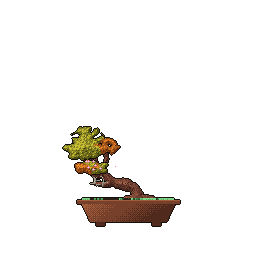
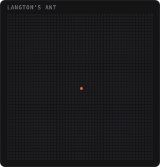
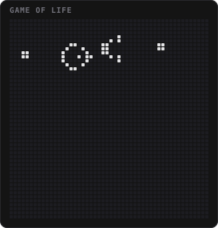
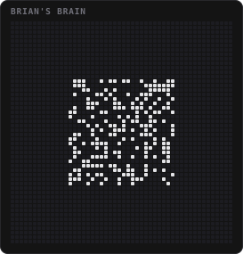

  
    
  

  <h3> Hi, I'm Yizaha / Rexshimura!</h3>

  

  

    I specialize in building smooth, professional <strong>frontends</strong> and logical <strong>backends</strong> tailored to what you need—using modern frameworks, tools, and <strong>AI</strong> (usually <strong>React + Vite</strong>).
  

  

    I'm also an aspiring <strong>Game Developer</strong> exploring <strong>Mobile Dev</strong> and game development across <strong>Web, Desktop, Roblox &amp; Unity</strong>. I love building niche tools and ideas that improve workflow efficiency and make life easier for myself and others.
  

  

  

<table>
  <tr>
    <td width="50%" valign="top">
      <h2> Architecture &amp; Workflow</h2>
      
How I take ideas from concept to clean, working systems:

      <ul>
        <li><strong>Frontend Craft:</strong> Smooth, responsive UIs built primarily with <strong>React + Vite</strong>.</li>
        <li><strong>Backend &amp; System Design:</strong> Storyboards, flowcharts, ERDs, and logical APIs tailored to the product.</li>
        <li><strong>AI-Assisted Engineering:</strong> Pairing modern frameworks with AI tooling for faster, cleaner iteration.</li>
        <li><strong>Niche Efficiency Tools:</strong> Building practical utilities and automations that simplify everyday workflows.</li>
      </ul>
    </td>
    <td width="50%" valign="top">
      <h2> Currently Exploring</h2>
      
Where I'm leveling up next across <strong>AI, Mobile &amp; Games</strong>:

      

         
        Building interactive worlds and gameplay systems across engines and platforms.
      

      

         
        Expanding into mobile apps for Android &amp; iOS.
      

      

         
        Integrating LLMs, tokenization, and AI workflows into practical applications.
      

    </td>
  </tr>
</table>

 

<h2 align="center"> Tech Stack</h2>

  <table>
    <tr>
      <td align="right"><strong>Frontend &amp; UI</strong></td>
      <td>
         &nbsp; &nbsp;
      </td>
    </tr>
    <tr>
      <td align="right"><strong>Backend &amp; Cloud</strong></td>
      <td>
        
      </td>
    </tr>
    <tr>
      <td align="right"><strong>Databases</strong></td>
      <td>
        
      </td>
    </tr>
    <tr>
      <td align="right"><strong>Languages</strong></td>
      <td>
        
      </td>
    </tr>
    <tr>
      <td align="right"><strong>Tools</strong></td>
      <td>
         &nbsp; &nbsp;
      </td>
    </tr>
  </table>

 

<h2 align="center"> GitHub Stats</h2>

  
  
   
  

 

<h2 align="center"> Connect with Me</h2>

  
  
  
  

 

  

 

  
  
  

 

  

 

<h2 align="center"> Featured Projects</h2>
